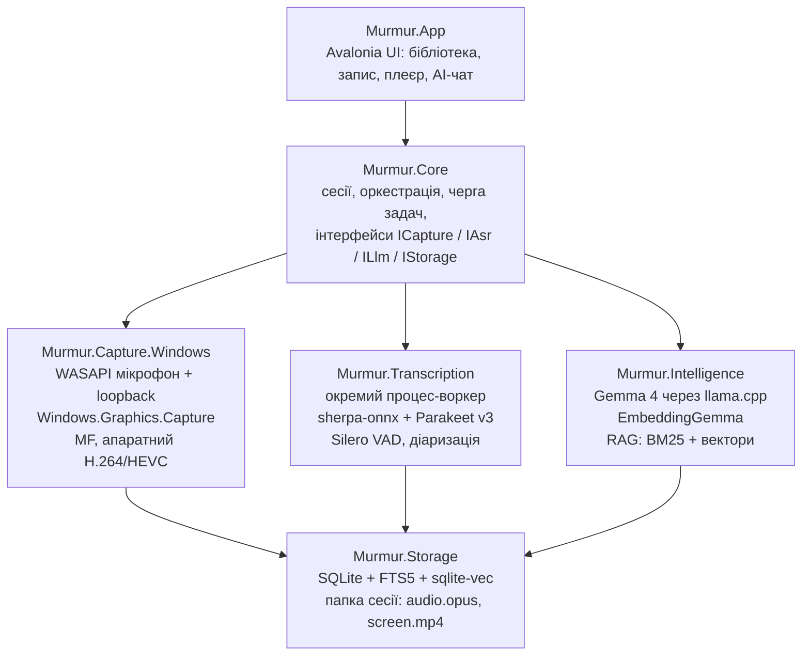

# Murmur — план MVP

Живий план проєкту. Архітектор оновлює галочки та статуси після кожної фази.

## Кодова назва: Murmur

**Murmur** — легкий локальний рекордер мітингів для Windows (потім macOS): звук + екран, транскрипція Parakeet, AI-пошук по записах через Gemma. Усе офлайн і безкоштовно.

## Цілі MVP

MVP = Windows 11 x64, один користувач, повністю офлайн.

**Входить:**

- Запис мікрофона і системного звуку окремими доріжками
- Запис екрана — перемикач перед і під час запису
- Транскрипція Parakeet TDT v3 після зупинки (живі субтитри — stretch-ціль)
- Бібліотека записів і плеєр: клік по слову → перемотка до моменту
- AI-пошук і чат по одному запису та по всій бібліотеці (Gemma, локально)

**Не входить:** macOS, диктування, хмара й синхронізація, акаунти, календар, монтаж відео.

**Цільові бюджети** (перевіряються бенчмарками):

| Метрика | Ціль |
| --- | --- |
| Холодний старт | < 400 мс |
| CPU у простої | < 1% |
| CPU, запис лише аудіо | < 3% |
| CPU, аудіо + екран 1080p30 | < 8% |
| RAM під час запису, без моделей | < 150 МБ |
| 1 год аудіо → текст на CPU | < 3 хв |

## Стек технологій

| Шар | Вибір | Чому |
| --- | --- | --- |
| Рантайм | .NET 11, C# 15, Native AOT | GA у листопаді 2026; AOT = швидкий старт, мала RAM |
| UI | Avalonia + CommunityToolkit.Mvvm (source-gen) | один UI для Windows і macOS, сумісний з AOT |
| Звук (Windows) | WASAPI: мікрофон + loopback, тонкий власний interop | без зайвих залежностей і алокацій |
| Екран (Windows) | Windows.Graphics.Capture → Media Foundation, апаратний H.264/HEVC | кадри не копіюються в CPU |
| Звук + екран (macOS, фаза 5) | ScreenCaptureKit + AVAssetWriter через Swift-міст | нативний шлях Apple |
| Транскрипція | sherpa-onnx (NuGet `org.k2fsa.sherpa.onnx`) + parakeet-tdt-0.6b-v3 int8 | готові C#-біндинги, CPU-only |
| VAD / спікери | Silero VAD + діаризація sherpa-onnx | той самий рантайм |
| LLM | Gemma 4 E4B за замовчуванням, 26B A4B для потужних ПК; llama.cpp через LLamaSharp (GGUF Q4) | Apache 2.0, локально |
| Ембедінги | EmbeddingGemma | семантичний пошук по транскриптах |
| Сховище | SQLite + FTS5 + sqlite-vec | один файл, повнотекст + вектори |
| AI-абстракція | Microsoft.Extensions.AI (`IChatClient`, `IEmbeddingGenerator`) | модель міняється без переписування |

Parakeet v3 покриває 25 європейських мов, включно з українською, російською та польською.

## Архітектура

UI знає лише Core; захоплення платформозалежне, тож для macOS додається тільки `Murmur.Capture.Mac`.



```text
Murmur.sln
├─ src/
│  ├─ Murmur.App               Avalonia UI, MVVM, дизайн-токени
│  ├─ Murmur.Core              домен, сесії, черга, інтерфейси
│  ├─ Murmur.Capture.Windows   WASAPI, WGC, Media Foundation
│  ├─ Murmur.Capture.Mac       фаза 5: ScreenCaptureKit-міст
│  ├─ Murmur.Transcription     sherpa-onnx, VAD, діаризація (воркер)
│  ├─ Murmur.Intelligence      Gemma, ембедінги, RAG
│  └─ Murmur.Storage           SQLite, FTS5, sqlite-vec, файли
└─ tests/
   ├─ Murmur.Core.Tests
   └─ Murmur.Benchmarks        BenchmarkDotNet, бюджети CPU/RAM
```

## Пайплайн: запис → текст → пошук

Запис ніколи не чекає на AI: важкі кроки йдуть після зупинки, у фоновій черзі.

1. **Запис.** Мікрофон і loopback пишуться окремими доріжками: 16 кГц mono PCM для ASR + Opus для відтворення. Екран — MP4 (апаратний H.264). Файли сесії скидаються на диск кожні кілька секунд, тож краш не губить запис.
2. **Транскрипція.** VAD ріже аудіо на фрагменти ≤ 15–20 с → Parakeet → текст із таймкодами слів. Доріжка мікрофона = «Я», loopback = «Інші» — дешева діаризація без моделі; розбиття «Інших» на людей — опційно.
3. **Індекс.** Сегменти → FTS5; чанки по 30–60 с → EmbeddingGemma → sqlite-vec.
4. **AI-пошук.** Запит → гібридний пошук (BM25 + вектори) → top-k чанків із таймкодами → Gemma відповідає з посиланнями `[12:34]` → клік відкриває момент у плеєрі.
5. **Після мітингу (опційно).** Резюме, action items, ключові рішення — також із таймкодами.

## Оптимізація

Головне правило: під час запису працює лише захоплення, моделі в памʼяті не тримаються.

- **Старт і памʼять:** Native AOT + trimming, жодної рефлексії — source-gen для JSON, MVVM, DI.
- **Аудіо:** lock-free ring buffer, `Span<T>` і `ArrayPool`, нуль алокацій у WASAPI-callback, ресемплінг один раз.
- **Відео:** zero-copy — D3D11-текстури йдуть прямо в апаратний енкодер (NVENC / Quick Sync / AMF).
- **Ізоляція:** транскрипція і LLM — в окремому процесі-воркері; краш моделі не валить запис.
- **Моделі:** ліниве завантаження, вивантаження після роботи; Parakeet int8 на CPU ≈ 28–42× швидше за реальний час. DirectML / CUDA — опція.
- **Черга:** пріоритети — запис > транскрипція > індекс > резюме; на слабких ПК AI не стартує, поки йде запис екрана.
- **UI:** віртуалізований транскрипт, waveform із закешованих піків, без анімацій на кожен кадр.
- **Контроль:** BenchmarkDotNet + перевірка розміру бінарника й CPU-бюджетів у CI.

## Дизайн у стилі ElevenLabs

Теплий «паперовий» мінімалізм: 97% ахроматики, тонкі заголовки, pill-кнопки; кольорові акценти — лише у візуалі запису. Беремо стиль, а не бренд: свої назви, іконки й візуал. Токени — `docs/design/tokens.json`, макети — `docs/design/`.

| Токен | Значення | Роль |
| --- | --- | --- |
| Canvas | `#fdfcfc` | фон вікна |
| Surface | `#f5f3f1` | картки, панелі |
| Stone | `#ebe8e4` | лінії 1px, роздільники |
| Ink | `#000000` | текст, головна кнопка |
| Smoke / Ash | `#777169` / `#a59f97` | другорядний / допоміжний текст |
| Violet / Ember | `#0447ff` / `#ff4704` | лише «сфера» запису та іконки, ніколи не UI |
| Типографіка | Inter 300 (заголовки, −0.02em), Inter 400/500 (текст), Geist Mono 13 (таймкоди) | Waldenburg платний → Inter 300 |
| Радіуси | кнопки 9999, картки 20, інпути 4 | |

Темна тема — друга черга, ті самі токени в теплих темних тонах.

**Екрани MVP:**

0. **Онбординг** — 5 кроків при першому запуску (див. нижче).
1. **Бібліотека** — список записів, pill-пошук зверху, фільтри за датою.
2. **Запис** — градієнтна «сфера», що дихає від рівня звуку; pill-перемикачі Мікрофон / Системний звук / Екран; таймер Geist Mono.
3. **Перегляд запису** — плеєр ліворуч, транскрипт праворуч із підсвіткою поточного слова; вкладки Транскрипт / Резюме / Запитати AI.
4. **AI-чат** — відповіді з чипами таймкодів.
5. **Налаштування** — моделі (завантаження, розмір), пристрої, папка, хоткеї.

### Онбординг (first-run experience)

Показується лише при першому запуску; повторити — з Налаштувань. Без реєстрації й акаунтів. Кожен крок, крім дозволу на мікрофон, можна пропустити. Макети: `docs/design/00-onboarding-*.png`, промт для дизайну: `docs/design/prompts/onboarding.md`.

1. **Вітання** — «Записує й розшифровує мітинги. Усе лишається на твоєму компʼютері». Анімована сфера, кнопка «Почати».
2. **Звук** — дозвіл на мікрофон, вибір мікрофона й виходу системного звуку, живі індикатори рівня для обох.
3. **Моделі** — Parakeet (≈ 0,67 ГБ) обовʼязково; Gemma E4B або 26B з розміром і рекомендацією під залізо, або «пропустити AI». Завантаження у фоні — можна йти далі.
4. **Налаштування** — мова транскрипції (авто / вибір), папка для записів і вільне місце, хоткей старт/стоп, запис екрана за замовчуванням.
5. **Пробний запис** — 10 с → одразу транскрипт; нагадування попереджати учасників мітингу про запис.

## Етапи та roadmap

Кожна фаза закінчується вимірюваним критерієм; наступна не стартує, поки критерій не пройдено.

| Фаза | Зміст | Критерій переходу | Статус |
| --- | --- | --- | --- |
| 0 · Фундамент | Solution, Native AOT, CI, дизайн-токени в Avalonia, інтерфейси Core | AOT-старт < 400 мс | ⬜ |
| 1 · Запис на Windows | Мікрофон + системний звук, екран через WGC + Media Foundation, crash-safe запис | 1 год запису без втрат, CPU у межах бюджету | ⬜ |
| 2 · Транскрипція | Parakeet v3, VAD, доріжки «Я / Інші», плеєр із синхроном | 1 год аудіо → текст < 3 хв на CPU | ⬜ |
| 3 · AI-пошук | FTS5 + вектори, Gemma 4, чат із таймкодами | Відповідь AI веде на правильну хвилину запису | ⬜ |
| 4 · Реліз MVP (Windows) | Онбординг, інсталятор, моделі завантажуються при першому запуску | 5 реальних мітингів без збоїв і втрат | ⬜ |
| 5 · macOS | ScreenCaptureKit, CoreML / Metal, підпис і нотаризація | старт після релізу MVP | ⬜ |

**Задачі фази 0:**

- [ ] Solution за структурою вище
- [ ] Avalonia-вікно з дизайн-токенами, зібране Native AOT
- [ ] Інтерфейси `ICapture`, `IAsr`, `ILlm`, `IStorage` у Core (без реалізацій)
- [ ] CI: build + тести + AOT-публікація win-x64 + BenchmarkDotNet
- [ ] Спайк: 10 с WASAPI loopback → sherpa-onnx → текст у консолі

## Ризики та відкриті питання

| Ризик | Що робимо |
| --- | --- |
| .NET 11 ще не GA (листопад 2026) | стартуємо на RC, оновлюємось на GA |
| LLamaSharp відстає від llama.cpp щодо Gemma 4 | fallback: `llama-server` як sidecar або ONNX Runtime GenAI |
| Бібліотеки ламають Native AOT | брати лише AOT-сумісні, перевірка AOT-збірки в CI |
| Loopback змішує всіх співрозмовників | діаризація sherpa-onnx, тест на реальних мітингах |
| Вага моделей: Parakeet int8 ≈ 0,67 ГБ + Gemma кілька ГБ | завантаження при першому запуску, вибір моделі в налаштуваннях |
| Ліцензії | Parakeet — CC-BY-4.0 (атрибуція в About), Gemma 4 — Apache 2.0, код — Apache 2.0 (LICENSE у репо) |
| Згода учасників на запис | помітний індикатор запису + нагадування повідомити учасників |

**Відкрито:**

- [ ] Чи вистачає 25 мов Parakeet v3, чи потрібен Whisper як запасний рушій?
- [ ] Мінімальне залізо: GPU обовʼязковий для Gemma чи CPU-режим з E2B?
- [ ] Запис екрана: весь монітор чи вибране вікно?
- [ ] Gemma 4 E2B/E4B вміють слухати аудіо — протестувати «питання до звуку» напряму у фазі 3+.
