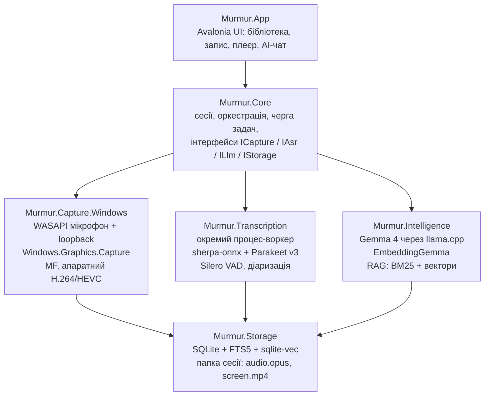

# Murmur — план MVP

Живий план проєкту. Архітектор оновлює галочки та статуси після кожної фази.

## Кодова назва: Murmur

**Murmur** — легкий локальний рекордер мітингів для Windows (потім macOS): звук + екран, транскрипція Parakeet, AI-пошук по записах через Gemma. Усе офлайн і безкоштовно.

## Цілі MVP

MVP = Windows 11 x64, один користувач, повністю офлайн.

**Входить:**

- Запис мікрофона і системного звуку окремими доріжками
- Запис екрана — перемикач перед і під час запису; 1080p60, щоб запис можна було переглянути в нормальній якості синхронно зі звуком (D-030)
- Транскрипція Parakeet TDT v3 після зупинки (живі субтитри — stretch-ціль)
- Бібліотека записів і плеєр: клік по слову → перемотка до моменту
- AI-пошук і чат по одному запису та по всій бібліотеці (Gemma, локально)

**Не входить:** macOS, диктування, хмара й синхронізація, акаунти, календар, монтаж відео.

**Цільові бюджети** (перевіряються бенчмарками):

| Метрика | Ціль |
| --- | --- |
| Холодний старт | < 400 мс |
| CPU у простої | < 1% |
| CPU, запис лише аудіо | < 3% |
| CPU, аудіо + екран 1080p60 (GPU-шлях) | < 8% |
| RAM під час запису лише аудіо, без моделей | < 150 МБ |
| RAM під час запису аудіо + екран 1080p60, без моделей | без жорсткої межі — скільки треба для якості, але без росту: < 1 МБ/хв після першої хвилини (D-029) |
| 1 год аудіо → текст на CPU | < 3 хв |

## Стек технологій

| Шар | Вибір | Чому |
| --- | --- | --- |
| Рантайм | .NET 11, C# 15, Native AOT | GA у листопаді 2026; AOT = швидкий старт, мала RAM |
| UI | Avalonia + CommunityToolkit.Mvvm (source-gen) | один UI для Windows і macOS, сумісний з AOT |
| Звук (Windows) | WASAPI: мікрофон + loopback, тонкий власний interop | без зайвих залежностей і алокацій |
| Екран (Windows) | Windows.Graphics.Capture → Media Foundation, апаратний H.264/HEVC | кадри не копіюються в CPU |
| Звук + екран (macOS, фаза 5) | ScreenCaptureKit + AVAssetWriter через Swift-міст | нативний шлях Apple |
| Транскрипція | sherpa-onnx (NuGet `org.k2fsa.sherpa.onnx`) + parakeet-tdt-0.6b-v3 int8 | готові C#-біндинги, CPU-only |
| VAD / спікери | Silero VAD + діаризація sherpa-onnx | той самий рантайм |
| LLM | Gemma 4 E4B за замовчуванням, 26B A4B для потужних ПК; llama.cpp через LLamaSharp (GGUF Q4) | Apache 2.0, локально |
| Ембедінги | EmbeddingGemma | семантичний пошук по транскриптах |
| Сховище | SQLite + FTS5 + sqlite-vec | один файл, повнотекст + вектори |
| AI-абстракція | Microsoft.Extensions.AI (`IChatClient`, `IEmbeddingGenerator`) | модель міняється без переписування |

Parakeet v3 покриває 25 європейських мов, включно з українською, російською та польською.

## Архітектура

UI знає лише Core; захоплення платформозалежне, тож для macOS додається тільки `Murmur.Capture.Mac`.



```text
Murmur.sln
├─ src/
│  ├─ Murmur.App               Avalonia UI, MVVM, дизайн-токени
│  ├─ Murmur.Core              домен, сесії, черга, інтерфейси
│  ├─ Murmur.Capture.Windows   WASAPI, WGC, Media Foundation
│  ├─ Murmur.Capture.Mac       фаза 5: ScreenCaptureKit-міст
│  ├─ Murmur.Transcription     sherpa-onnx, VAD, діаризація (воркер)
│  ├─ Murmur.Intelligence      Gemma, ембедінги, RAG
│  └─ Murmur.Storage           SQLite, FTS5, sqlite-vec, файли
└─ tests/
   ├─ Murmur.Core.Tests
   └─ Murmur.Benchmarks        BenchmarkDotNet, бюджети CPU/RAM
```

## Пайплайн: запис → текст → пошук

Запис ніколи не чекає на AI: важкі кроки йдуть після зупинки, у фоновій черзі.

1. **Запис.** Мікрофон і loopback пишуться окремими доріжками: 16 кГц mono PCM для ASR + Opus для відтворення. Екран — MP4 (апаратний H.264). Файли сесії скидаються на диск кожні кілька секунд, тож краш не губить запис.
2. **Транскрипція.** VAD ріже аудіо на фрагменти ≤ 15–20 с → Parakeet → текст із таймкодами слів. Доріжка мікрофона = «Я», loopback = «Інші» — дешева діаризація без моделі; розбиття «Інших» на людей — опційно.
3. **Індекс.** Сегменти → FTS5; чанки по 30–60 с → EmbeddingGemma → sqlite-vec.
4. **AI-пошук.** Запит → гібридний пошук (BM25 + вектори) → top-k чанків із таймкодами → Gemma відповідає з посиланнями `[12:34]` → клік відкриває момент у плеєрі.
5. **Після мітингу (опційно).** Резюме, action items, ключові рішення — також із таймкодами.

## Оптимізація

Головне правило: під час запису працює лише захоплення, моделі в памʼяті не тримаються.

- **Старт і памʼять:** Native AOT + trimming, жодної рефлексії — source-gen для JSON, MVVM, DI.
- **Аудіо:** lock-free ring buffer, `Span<T>` і `ArrayPool`, нуль алокацій у WASAPI-callback, ресемплінг один раз.
- **Відео:** zero-copy — D3D11-текстури йдуть прямо в апаратний енкодер (NVENC / Quick Sync / AMF).
- **Ізоляція:** транскрипція і LLM — в окремому процесі-воркері; краш моделі не валить запис.
- **Моделі:** ліниве завантаження, вивантаження після роботи; Parakeet int8 на CPU ≈ 28–42× швидше за реальний час. DirectML / CUDA — опція.
- **Черга:** пріоритети — запис > транскрипція > індекс > резюме; на слабких ПК AI не стартує, поки йде запис екрана.
- **UI:** віртуалізований транскрипт, waveform із закешованих піків, без анімацій на кожен кадр.
- **Контроль:** BenchmarkDotNet + перевірка розміру бінарника й CPU-бюджетів у CI.

## Дизайн у стилі ElevenLabs

Теплий «паперовий» мінімалізм: 97% ахроматики, тонкі заголовки, pill-кнопки; кольорові акценти — лише у візуалі запису. Беремо стиль, а не бренд: свої назви, іконки й візуал. Токени — `docs/design/tokens.json`, макети — `docs/design/`.

| Токен | Значення | Роль |
| --- | --- | --- |
| Canvas | `#fdfcfc` | фон вікна |
| Surface | `#f5f3f1` | картки, панелі |
| Stone | `#ebe8e4` | лінії 1px, роздільники |
| Ink | `#000000` | текст, головна кнопка |
| Smoke / Ash | `#777169` / `#a59f97` | другорядний / допоміжний текст |
| Violet / Ember | `#0447ff` / `#ff4704` | лише «сфера» запису та іконки, ніколи не UI |
| Типографіка | Inter 300 (заголовки, −0.02em), Inter 400/500 (текст), Geist Mono 13 (таймкоди) | Waldenburg платний → Inter 300 |
| Радіуси | кнопки 9999, картки 20, інпути 4 | |

Світла й темна теми вже намальовані (токени `color` і `colorDark` у `tokens.json`). Вихідники макетів — `docs/design/source/`.

**Екрани MVP:**

0. **Онбординг** — 5 кроків при першому запуску (див. нижче).
1. **Бібліотека** — список записів, pill-пошук зверху, фільтри за датою.
2. **Запис** — градієнтна «сфера», що дихає від рівня звуку; pill-перемикачі Мікрофон / Системний звук / Екран; таймер Geist Mono.
3. **Перегляд запису** — плеєр ліворуч, транскрипт праворуч із підсвіткою поточного слова; вкладки Транскрипт / Резюме / Запитати AI.
4. **AI-чат** — відповіді з чипами таймкодів.
5. **Налаштування** — моделі (завантаження, розмір), пристрої, папка, хоткеї.

### Онбординг (first-run experience)

Показується лише при першому запуску; повторити — з Налаштувань. Без реєстрації й акаунтів. Кожен крок, крім дозволу на мікрофон, можна пропустити. Макети: `docs/design/00-onboarding-*.png`, промт для дизайну: `docs/design/prompts/onboarding.md`.

1. **Вітання** — «Записує й розшифровує мітинги. Усе лишається на твоєму компʼютері». Анімована сфера, кнопка «Почати».
2. **Звук** — дозвіл на мікрофон, вибір мікрофона й виходу системного звуку, живі індикатори рівня для обох.
3. **Моделі** — Parakeet (≈ 0,67 ГБ) обовʼязково; Gemma E4B або 26B з розміром і рекомендацією під залізо, або «пропустити AI». Завантаження у фоні — можна йти далі.
4. **Налаштування** — мова транскрипції (авто / вибір), папка для записів і вільне місце, хоткей старт/стоп, запис екрана за замовчуванням.
5. **Пробний запис** — 10 с → одразу транскрипт; нагадування попереджати учасників мітингу про запис.

## Етапи та roadmap

Кожна фаза закінчується вимірюваним критерієм; наступна не стартує, поки критерій не пройдено.

| Фаза | Зміст | Критерій переходу | Статус |
| --- | --- | --- | --- |
| 0 · Фундамент | Solution, Native AOT, CI, дизайн-токени в Avalonia, інтерфейси Core | AOT-старт < 400 мс | ✅ медіана 289 мс, холодний 362 мс (CI windows-latest, 7 запусків) |
| 1 · Запис на Windows | Мікрофон + системний звук, екран через WGC + Media Foundation, crash-safe запис | 1 год запису без втрат, CPU у межах бюджету | ✅ 2 × 1 год реального запису на Windows CI: 0 втрат, CPU 1,25–1,48% (бюджет 3%), RAM ≤ 104 МБ; з екраном (10 хв) CPU 7,17% (бюджет 8%), але RAM 159 МБ і аудіо +1,03 с — відкриті ризики; мікрофон — ручна перевірка; див. docs/REPORTS/night-run.md |
| 2 · Транскрипція | Parakeet v3, VAD, доріжки «Я / Інші», плеєр із синхроном | 1 год аудіо → текст < 3 хв на CPU | ⚠️ зроблено; 1 год → 89,5 с на 4 vCPU Zen 5 ✅, 197–227 с на 4 vCPU Zen 3 ❌ — перевірити на цільовому ПК |
| 3 · AI-пошук | FTS5 + вектори, Gemma 4, чат із таймкодами | Відповідь AI веде на правильну хвилину запису | ✅ eval з реальною Gemma 4 E4B: 11/12 (92%) у межах ±60 с (після D-028; до фіксу 10/12 і 8/12) |
| 4 · Реліз MVP (Windows) | Запис екрана 1080p60 і його перегляд (задачі нижче), онбординг, інсталятор, моделі завантажуються при першому запуску | 5 реальних мітингів без збоїв і втрат | 🟡 код фази готовий, CI зелений, ai-eval 11/12; чекає перевірки власника — docs/REPORTS/phase4.md |
| 4.1 · Дизайн 1:1 (Windows) | Кожен екран точно за канвасом (англійською, світла й темна), усе, що намальовано, працює: пауза запису, підсумок і експорт запису, історія чатів, фільтр за датами, розділи налаштувань; англійська за замовчуванням (D-039) | 24 артборди канвасу збігаються із застосунком у `DesignParityTests` у межах порогу (D-041); власник підтверджує на ПК | 🟡 у роботі — стан і черга: `docs/REPORTS/phase41-status.md` |
| 5 · macOS | ScreenCaptureKit, CoreML / Metal, підпис і нотаризація | старт після того, як усе зроблено на Windows (D-040) | ⏸ відкладено |

**Задачі фази 0:**

- [x] Solution за структурою вище (+ `Murmur.Desktop` як composition root, D-004)
- [x] Avalonia-вікно з дизайн-токенами, зібране Native AOT
- [x] Інтерфейси `ICapture`, `IAsr`, `ILlm`, `IStorage` у Core (без реалізацій)
- [x] CI: build + тести + AOT-публікація win-x64 + BenchmarkDotNet
- [x] Спайк: 10 с WASAPI loopback → sherpa-onnx → текст у консолі (ASR + AOT перевірено на Linux; loopback-частину — лише компіляція, перевірити на Windows)

**Перевірка на ПК власника (2026-10-18)**, Ryzen 7 5800X3D (8 ядер / 16 потоків), RX 9070 XT, Native AOT:
- фаза 2: 1 год аудіо → текст за 96,8 с (бюджет 180 с) ✅;
- фаза 3: AI-eval з Gemma 4 E4B 11/12 (92%), середня відповідь 37,6 с;
- старт: медіана 371 мс (бюджет 400 мс), перший запуск 728 мс ⚠️;
- запис лише аудіо 12 хв: CPU 0,10%, RAM 119 МБ, пам'ять не росте, звук рівно в часі ✅.

Знайдено й виправлено (PR #2–#4):
- запис екрана на GPU зупинявся після 12 кадрів;
- робочий набір ріс на 4,5–4,9 МБ/хв, бо на великому L3 gen0 не збирався;
- `check-recording.ps1` не перевіряв довжину відео.

Відкрите: таймлайн MP4 на статичному екрані, RAM з екраном 170 МБ, червоний тест лічильника алокацій. Усі вони в задачах нижче.

**Задачі фази 4 — запис екрана 1080p60 і перегляд** (рішення власника 2026-10-18, D-029, D-030):
- [x] Лічильник алокацій потоку запису не рахує зупинку (PR #6). Тест падає на CI, коли під час зупинки потік запису втрачає lock: .NET 11 тоді один раз створює `AutoResetEvent` (56 Б).
- [x] Таймлайн MP4 дорівнює реальному часу на будь-якому вмісті (PR #7). Змінна частота кадрів: тривалість семпла = реальний проміжок до наступного. Зараз 10 хв статичного екрана програються за 22,75 с.
- [x] 1080p60 на GPU-шляху, VBR із середнім 12 Мбіт/с замість CBR, пул семплів під 60 кадрів/с, CPU readback без GPU — не більше 30 кадрів/с (PR #8).
- [ ] **Власник:** заміри на ПК з AOT, 10 хв з рухомим вмістом. Критерій: CPU < 8%, RAM не росте (< 1 МБ/хв після першої хвилини), ~60 кадрів/с, 0 втрат, відео = тривалість запису ± 2 с, після краша губиться ≤ 3 с відео. Абсолютну RAM і розмір файлу за годину для статичного й рухомого екрана записати довідково.
- [x] Плеєр екрана в «Перегляді запису»: відео синхронно зі звуком і транскриптом, клік по слову перемотує й відео (Media Foundation Media Engine, альтернатива з D-020). Хвиля 2: інтерфейс `IVideoPlayer` у Core + синхронізація з аудіо-годинником (Core) → плеєр Media Engine у режимі frame-server (`Murmur.Capture.Windows`, D-035) → UI (`SessionView`).
- [x] Синхрон звуку й відео: з екраном звук на 0,43–0,48 с довший за запис, без екрана — ні. Причина: `WgcScreenRecorder` ставив нуль таймлайну MP4 після ініціалізації енкодера й сесії захоплення (~0,45 с), а `Recorder` бере `Offset` до виклику; харнес міряв `durationS` після старту екрана. Хвиля 1: `fix/screen-av-sync-start` (D-033).
- [x] Помилки екрана (вичерпаний пул, перехід на CPU readback) доходять до сесії й perf JSON: `Recorder` підписується на `IScreenRecorder.Faulted`, нефатальні — як попередження сесії. Це зміна інтерфейсу Core. Хвиля 2 (ті самі файли, що й синхрон). Типи збоїв — `CaptureFaultKind` (D-038); фатальний збій закінчує сегмент, звук пишеться далі.

**Задачі фази 4 — онбординг, налаштування, моделі, інсталятор:**
- [x] Менеджер моделей: каталог, докачка, перевірка, атомарне встановлення в той самий layout, що читає застосунок; CI-перевірка каталогу (`models.yml`). Новий проєкт `Murmur.Models` (D-031). Кілька джерел на файл (E4B — з `unsloth`, у `ggml-org` її немає), SHA-256 і ревізії Hugging Face (`resolve/<commit>`) закріплені для всіх джерел, `ModelFetch --resolve-pins` у `models.yml` ловить розбіжність з upstream.
- [x] Тема світла / темна / системна в рантаймі (токени `color` / `colorDark`), рядки UI в `.resx` (uk + en, обидві в збірці — D-034), налаштування на диску (`ISettingsStore`, `settings.json`). Мова застосовується з наступного запуску (D-032).
- [x] Екран «Налаштування» за макетом `Settings.dc.html`: моделі (встановлення, видалення, розмір, прогрес), пристрої, папка записів, хоткей, тема, мова, «пройти онбординг ще раз». Хвиля 2.
- [x] Глобальний хоткей старт/стоп: `RegisterHotKey` у `Murmur.Capture.Windows` за інтерфейсом у Core. Хвиля 2. Три дії (старт/стоп, екран, показати вікно), F13–F24 без модифікаторів; один екземпляр застосунку (м'ютекс `MurmurSingleInstance`, `AppMutex` в інсталяторі).
- [x] Онбординг, 5 кроків за макетами `Onb1`–`Onb5`: вітання, звук (дозвіл на мікрофон, пристрої, живі рівні), моделі (Parakeet обовʼязково; Gemma E4B / 26B з рекомендацією або «пропустити AI», завантаження у фоні), налаштування, пробний запис 10 с → транскрипт. Хвиля 3 (після менеджера моделей, теми й налаштувань).
- [x] Папка записів з налаштувань (`AppSettings.RecordingsDirectory`) у `Murmur.Storage`. Хвиля 2.
- [x] Інсталятор — Inno Setup, на користувача без прав адміністратора (D-036); ASR-воркер `Murmur.Transcription` у тому самому пакеті; версія 0.4.0 (D-037). CI будує інсталятор і перевіряє тихе встановлення → старт → видалення.
- [ ] **Власник:** критерій фази — 5 реальних мітингів без збоїв і втрат.

**Задачі фази 4.1 — дизайн 1:1** (рішення власника 2026-10-20: дизайн не збігається з макетом; англійська за замовчуванням; macOS — потім). Канвас оновлено англійською, еталонні рендери — `docs/design/reference` (D-041).
- [x] Хвиля 1 · `p41-parity-harness`: `DesignParityTests` рендерять кожен артборд застосунком з даними макета, тим самим розміром і темою, пишуть порівняння й звіт (`artifacts/design-parity`).
- [x] Хвиля 1 · `p41-english-default`: англійська — нейтральні ресурси й мова за замовчуванням, українська — друга (D-039).
- [x] Хвиля 2 · `p41-shell-library`: бічна панель усіх основних екранів (кнопка запису / стан «Recording», навігація, Recent / Chats / Sections, картка «Fully offline», верхня смуга з хлібними крихтами й підказкою хоткея) і бібліотека: «What are we recording today?», картки нового запису й «Ask your library» з підказками, пошук, фільтри All / Today / This week / This month / Pick dates, групи за днями, рядки з іконкою, метою, уривком або прогресом транскрипції.
- [x] Хвиля 2 · `p41-recording`: екран запису за макетом; пауза й продовження запису (Core: `IRecorder`), картка «Let people know» з копіюванням повідомлення, доріжки з рівнями й пристроями.
- [x] Хвиля 2 · `p41-onboarding`: 5 кроків, «Models — ready» і компоненти — довести до порогу. Злито в `phase4.1`; значення канвасу онбордингу й запису — токени (D-044), форма 0,5–4,6 % на 12 артбордах, тексти 100 %.
- [ ] Хвиля 3 · `p41-session`: перегляд запису — Export, меню «…», відеопанель, плеєр з хвилею, фільтрами You / Others і швидкістю, вкладки Transcript / Summary / Ask AI, пошук у транскрипті; Summary — підсумок локальною Gemma.
- [ ] Хвиля 3 · `p41-chat`: Ask AI — історія чатів у бічній панелі (зберігається), область пошуку, чипи таймкодів, джерела, копіювати / перегенерувати.
- [ ] Хвиля 3 · `p41-settings`: налаштування — розділи в бічній панелі, рядки моделей (VAD, «Default», прогрес), Acceleration (CPU / Vulkan / CUDA, D-042), пристрої, сховище, хоткеї (з паузою), About.
- [x] Паралельно · `p41-gpu-acceleration`: збірки `llama-server` з Vulkan і CUDA 12 завантажуються на вимогу, вибір у налаштуваннях, повернення на CPU, якщо GPU не стартує (D-042).
- [x] Після хвилі 2 · `p41-reduced-motion`: системне «зменшення анімації» Windows (Animation effects) зупиняє орби й їхні таймери; рівні й прогрес працюють далі. Звіт — `docs/REPORTS/p41-reduced-motion.md`.
- [x] Хвиля 1 · `p41-core-texts`: Core віддає коди, а слова обома мовами — у застосунку (D-043).
- [ ] **Власник:** перевірка на ПК — екрани збігаються з канвасом.

Мова транскрипції в онбордингу: Parakeet TDT v3 визначає мову сам, явного вибору мови в нього немає — у MVP пункт лишається «авто» (вибір мови — коли зʼявиться другий рушій, BACKLOG).

## Ризики та відкриті питання

| Ризик | Що робимо |
| --- | --- |
| .NET 11 ще не GA (листопад 2026) | стартуємо на RC, оновлюємось на GA |
| LLamaSharp відстає від llama.cpp щодо Gemma 4 | fallback: `llama-server` як sidecar або ONNX Runtime GenAI |
| Бібліотеки ламають Native AOT | брати лише AOT-сумісні, перевірка AOT-збірки в CI |
| Loopback змішує всіх співрозмовників | діаризація sherpa-onnx, тест на реальних мітингах |
| Вага моделей: Parakeet int8 ≈ 0,67 ГБ + Gemma кілька ГБ | завантаження при першому запуску, вибір моделі в налаштуваннях |
| Ліцензії | Parakeet — CC-BY-4.0 (атрибуція в About), Gemma 4 — Apache 2.0, код — Apache 2.0 (LICENSE у репо) |
| Згода учасників на запис | помітний індикатор запису + нагадування повідомити учасників |

**Відкрито:**

- [ ] Чи вистачає 25 мов Parakeet v3, чи потрібен Whisper як запасний рушій?
- [ ] Мінімальне залізо: GPU обовʼязковий для Gemma чи CPU-режим з E2B?
- [ ] Запис екрана: весь монітор чи вибране вікно?
- [ ] Gemma 4 E2B/E4B вміють слухати аудіо — протестувати «питання до звуку» напряму у фазі 3+.
